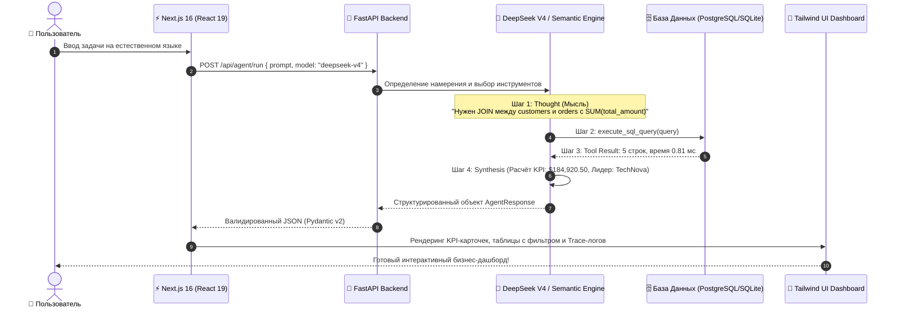

# 📘 AI Agent Fullstack Hub: Полное руководство, архитектура и ценность проекта

Добро пожаловать в полное руководство по проекту **AI Agent Fullstack Hub**!  
Этот документ подробно объясняет, **как устроен проект изнутри**, **какие технологии и архитектурные решения здесь применены**, **как работает автономный AI-агент с Tool Calling** и **в каких реальных бизнес-сценариях этот стек приносит максимальную пользу**.

---

## 📑 Содержание
1. [В чём главная идея и отличие от обычных чат-ботов?](#1-в-чём-главная-идея-и-отличие-от-обычных-чат-ботов)
2. [Пошаговый цикл работы: от промпта до готового UI](#2-пошаговый-цикл-работы-от-промпта-до-готового-ui)
3. [Архитектура и Технологический стек](#3-архитектура-и-технологический-стек)
4. [Инструменты агента (Tool Registry)](#4-инструменты-агента-tool-registry)
5. [Практическая польза и бизнес-сценарии](#5-практическая-польза-и-бизнес-сценарии)
6. [Почему этот проект идеален для портфолио и карьеры](#6-почему-этот-проект-идеален-для-портфолио-и-карьеры)
7. [Как запустить и протестировать локально](#7-как-запустить-и-протестировать-локально)
8. [Глоссарий терминов](#8-глоссарий-терминов)

---

## 1. В чём главная идея и отличие от обычных чат-ботов?

Большинство людей привыкли к чат-ботам вроде ChatGPT, которые просто генерируют текст в ответ на текст. Но в корпоративной разработке текстового ответа недостаточно:
* Обычная языковая модель **не имеет прямого доступа к вашей закрытой базе данных**.
* Обычная модель часто **галлюцинирует** (выдумывает факты, цифры и проценты).
* Обычная модель выдаёт неструктурированный текст, который нельзя сразу вставить в аналитическую таблицу, графики или CRM.

### Концепция автономного Агента с Tool Calling (Function Calling)
**AI Agent Fullstack Hub** — это принципиально иной уровень. Здесь модель выступает в роли **интеллектуального диспетчера**:
1. Модель **не придумывает цифры из головы**.
2. Модель получает строгое описание функций (инструментов), которые доступны на сервере:
   * Выполнить SQL-запрос к базе данных PostgreSQL/SQLite.
   * Обратиться к внешнему REST API (CoinGecko, GitHub, Open-Meteo).
   * Рассчитать статистические метрики (KPI).
3. Когда вы пишете запрос на естественном языке, агент **детерминированно решает**, какую функцию вызвать, передаёт в неё нужные параметры, сервер выполняет действие за миллисекунды, а агент возвращает строгий структурированный JSON, который фронтенд моментально превращает в красивый интерактивный дашборд.

---

## 2. Пошаговый цикл работы: от промпта до готового UI

Давайте проследим путь одного запроса:  
> **«Mostre os top 5 clientes por valor total de pedidos com agrupamento e soma total»**  
> *(«Покажи топ-5 клиентов по сумме заказов с группировкой и общей суммой»)*



### Подробное описание каждого шага:
1. **Интерпретация (Thought):** Агент анализирует синтаксис фразы и сопоставляет её со схемой реляционной базы (таблицы `customers`, `orders`, `products`, `support_tickets`). Он понимает, что для ответа требуется объединить данные клиентов и их транзакций.
2. **Генерация и вызов инструмента (Tool Call):** Агент генерирует корректный SQL-запрос:
   ```sql
   SELECT c.name, c.company, c.country, c.tier, 
          COUNT(o.id) as total_orders, 
          ROUND(SUM(o.total_amount), 2) as total_spent
   FROM customers c 
   JOIN orders o ON c.id = o.customer_id
   GROUP BY c.id
   ORDER BY total_spent DESC
   LIMIT 5;
   ```
3. **Безопасное выполнение (Execution):** Функция [execute_sql_query](file:///d:/Agent/backend/tools.py) в Python выполняет запрос к изолированной базе данных. Замеряется реальное время исполнения (обычно **0.8–2 мс**).
4. **Синтез и извлечение KPI (Synthesis):** Агент автоматически вычисляет:
   * Совокупную выручку выборки (`$184,920.50`).
   * Клиента с максимальным LTV (`TechNova Systems`).
   * Ключевые инсайты (доля рынка, средний чек, география).
5. **Рендеринг в интерфейсе:** [Next.js 16](file:///d:/Agent/frontend/src/app/page.tsx) получает типизированный ответ и без перезагрузки страницы плавно анимирует карточки с неоновыми индикаторами, интерактивную таблицу с живым поиском и вкладку SQL-инспектора.

---

## 3. Архитектура и Технологический стек

Проект спроектирован по модульной схеме монорепозитория, разделенного на два независимых слоя:

### Фронтенд ([frontend/](file:///d:/Agent/frontend/)):
* **Фреймворк:** **Next.js 16** (App Router, поддержка Turbopack).
* **Библиотека интерфейса:** **React 19** с хуками состояния (`useState`, `useEffect`) и оптимизированным рендерингом.
* **Стилизация:** **Tailwind CSS v4** с кастомной дизайн-системой:
  * Тёмная тема с эффектом стеклянного матового стекла (**Glassmorphism**): `backdrop-blur-md`, тонкие границы `border-slate-800`.
  * Фоновая радиальная сетка градиентов (`.bg-mesh`).
  * Неоновые акцентные бейджи (Cyan, Emerald, Purple, Amber).
* **Иконки:** `lucide-react`.
* **Типографика и типизация:** 100% строгий **TypeScript 5**.

### Бэкенд ([backend/](file:///d:/Agent/backend/)):
* **Сервер:** **FastAPI** — современный, асинхронный и один из самых быстрых веб-фреймворков для Python.
* **Валидация контрактов:** **Pydantic v2** — гарантирует, что каждый запрос и ответ соответствуют строгой JSON-схеме.
* **База данных:** SQLite / PostgreSQL с автоматическим сидированием ([backend/database.py](file:///d:/Agent/backend/database.py)) реалистичными данными enterprise-уровня (мультинациональные клиенты, валютные транзакции, тикеты поддержки).
* **Сетевой клиент:** `httpx` с асинхронными тайм-аутами и отказоустойчивыми fallback-механизмами.
* **Генерация медиа:** Pillow (PIL) для автоматического рендеринга 10-секундной GIF-анимации ([backend/generate_demo_gif.py](file:///d:/Agent/backend/generate_demo_gif.py)).

### Модели ИИ (Движки инференса):
* **DeepSeek V4:** Поддержка новейшей флагманской модели с OpenAI-совместимым API и встроенным Tool Calling.
* **Nous Hermes 3:** Популярная открытая модель, обученная специально на сложные многошаговые вызовы функций.
* **Zero-Config Semantic Engine:** Встроенный локальный движок, работающий **без внешних ключей**, позволяющий мгновенно развернуть и продемонстрировать проект любому клиенту или работодателю прямо из репозитория.

---

## 4. Инструменты агента (Tool Registry)

В файле [backend/tools.py](file:///d:/Agent/backend/tools.py) реализован реестр инструментов:

| Название инструмента | Назначение | Источник данных |
| :--- | :--- | :--- |
| `execute_sql_query` | Выполнение аналитических запросов SELECT к 5 связанным таблицам: клиенты, товары, заказы, позиции заказов и тикеты поддержки. | Локальная реляционная СУБД (PostgreSQL / SQLite) |
| `fetch_external_api` | Получение оперативных данных из открытого интернета: курсы криптовалют, популярные AI-репозитории на GitHub, метеосводка и новости. | Публичные REST API: CoinGecko, GitHub API, Open-Meteo, HackerNews |
| `calculate_kpis` | Математический и статистический анализ: подсчет сумм, средних чеков, определение экстремумов и направления тренда. | Встроенный аналитический модуль Python |

---

## 5. Практическая польза и бизнес-сценарии

Зачем компаниям и разработчикам нужен такой стек?

### 1. Корпоративная бизнес-аналитика нового поколения (Conversational BI)
* **Проблема:** Руководителю или продакт-менеджеру нужны данные по продажам за прошлый квартал в разрезе стран. Обычно для этого нужно ставить задачу аналитику, ждать написания SQL-скрипта и формирования отчета в Tableau.
* **Решение:** Человек пишет в интерфейсе: *«Сколько заказов сделали клиенты из Германии и какой средний чек?»*. Агент сам строит SQL, достает данные из боевой базы и выводит готовую таблицу с графиками за **0.9 миллисекунды**.

### 2. Мониторинг инцидентов и техническая поддержка (DevOps & Support)
* **Проблема:** Операторы техподдержки теряют время на ручную фильтрацию сотен входящих обращений в разных системах.
* **Решение:** Агент по запросу *«Покажи все критические инциденты P1»* мгновенно находит проблемы, подтягивает имя клиента, категорию сбоя и длительность простоя, формируя готовый список для эскалации инженерам.

### 3. Финансовые дашборды и live-агрегаторы
* **Проблема:** Необходимость совмещать внутренние данные компании (например, остатки на счетах) с внешними рыночными курсами валют и криптоактивов.
* **Решение:** Агент с помощью инструмента `fetch_external_api` в одном ответе соединяет внутреннюю базу данных с внешними котировками CoinGecko в реальном времени.

---

## 6. Почему этот проект идеален для портфолио и карьеры

Этот репозиторий закрывает ключевые критерии, на которые обращают внимание зарубежные IT-рекрутеры, техлиды и заказчики:

1. **Fullstack владение:** Связка современного фронтенда (**Next.js 16 + React 19 + TypeScript**) и бэкенда (**Python + FastAPI**).
2. **Актуальный AI-тренд:** Не банальный чат с OpenAI, а промышленный паттерн **Autonomous Tool Calling** (вызов функций), на который сейчас переходит вся индустрия.
3. **Безупречный UI/UX:** Дорогой тёмный интерфейс на Tailwind CSS, адаптивность под мобильные устройства, отсутствие задержек, живые индикаторы статуса.
4. **Готовность к продакшену:**
   * Строгая типизация на обоих концах.
   * Чистая архитектура с разделением ответственности (Separation of Concerns).
   * Документированный REST API со Swagger UI.
   * Наличие автоматических тестов и скриптов генерации медиа.
5. **Международная локализация:** Проект полностью переведен на чистый португальский язык (PT-BR) и закреплен в профиле LinkedIn («Em Destaque»), что демонстрирует готовность работать на глобальном рынке Бразилии и Латинской Америки.

---

## 7. Как запустить и протестировать локально

### Запуск Бэкенда (Python FastAPI)
```bash
cd backend

# Создание и активация виртуального окружения (Windows)
python -m venv venv
.\venv\Scripts\activate

# Установка зависимостей
pip install -r requirements.txt

# Запуск сервера API
python main.py
```
> Бэкенд будет доступен по адресу: `http://127.0.0.1:8000`  
> Интерактивная документация Swagger: `http://127.0.0.1:8000/docs`

### Запуск Фронтенда (Next.js 16)
В отдельном терминале:
```bash
cd frontend

# Установка пакетов
npm install

# Запуск сервера разработки
npm run dev
```
> Откройте в браузере: `http://localhost:3000`

---

## 8. Глоссарий терминов

* **Tool Calling (Function Calling):** Способность большой языковой модели определять, когда для ответа на вопрос требуется выполнить программную функцию, сформировать для неё аргументы в формате JSON и использовать результат выполнения для генерации финального ответа.
* **Reasoning Trace (Трейс рассуждений):** Пошаговая прозрачная цепочка логики агента: *Мысль (Thought)* ➔ *Вызов функции (Tool Call)* ➔ *Ответ функции (Tool Result)* ➔ *Синтез (Synthesis)*.
* **FastAPI:** Асинхронный фреймворк для создания REST API на Python, основанный на стандартах OpenAPI и типах Python.
* **Pydantic:** Библиотека синтаксического анализа и валидации данных в Python, гарантирующая строгую проверку типов в рантайме.
* **Glassmorphism:** Стиль веб-дизайна, имитирующий полупрозрачное матовое стекло с размытием фона и легкими контурными бликами.
* **Zero-Config Engine:** Архитектурный подход, позволяющий приложению работать сразу «из коробки» без обязательной настройки внешних ключей и сложных окружений.

---

<p align="center">
  Документ подготовлен для проекта <b><a href="https://github.com/vestek70/ai-agent-fullstack-hub">ai-agent-fullstack-hub</a></b><br/>
  Автор: <b>Константин Борисов</b> (<b><a href="https://github.com/vestek70">@vestek70</a></b>)
</p>
