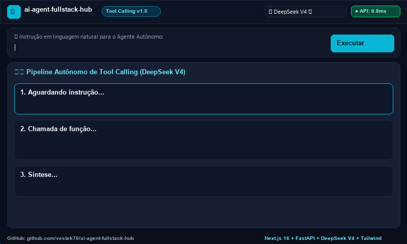
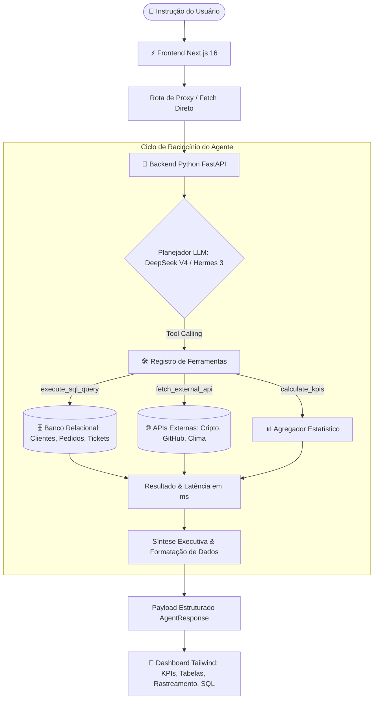

# ⚡ AI Agent Fullstack Hub

<p align="center">
  
</p>

<p align="center">
  <b>Aplicação Fullstack com Agente Autônomo de IA e Tool Calling (SQL + APIs), Next.js 16, Python FastAPI, DeepSeek V4 e Tailwind CSS</b>
</p>

<p align="center">
  <a href="https://github.com/vestek70/ai-agent-fullstack-hub"></a>
  <a href="https://github.com/vestek70/ai-agent-fullstack-hub"></a>
  <a href="https://github.com/vestek70/ai-agent-fullstack-hub"></a>
  <a href="https://github.com/vestek70/ai-agent-fullstack-hub"></a>
  <a href="https://github.com/vestek70/ai-agent-fullstack-hub"></a>
  <a href="https://github.com/vestek70/ai-agent-fullstack-hub"></a>
</p>

---

## 🌟 Visão Geral

O **AI Agent Fullstack Hub** é uma aplicação web empresarial de nível de produção desenvolvida para demonstrar a arquitetura moderna de **Agentes Autônomos de Inteligência Artificial** com capacidade de **Chamada de Funções / Ferramentas (Tool Calling)**.

O agente recebe tarefas em linguagem natural, decide autonomamente quais ferramentas locais ou externas acionar, executa consultas SQL de sub-milissegundo em banco relacional e requisições a APIs REST ao vivo, sintetizando os dados em relatórios executivos com cartões de KPIs dinâmicos e tabelas interativas estilizadas em **Tailwind CSS**.

### 🎯 Principais Destaques
- **Linguagem Natural para Execução Determinística**: Converte instruções do usuário em consultas SQL precisas ou parâmetros de APIs externas.
- **Chamada Autônoma de Ferramentas (Tool Calling)**:
  - 🗄️ **Motor SQL Empresarial**: Consulta tabelas relacionais em PostgreSQL/SQLite (`customers`, `orders`, `products`, `order_items`, `support_tickets`) com tempo de execução inferior a 1 ms.
  - 🌐 **APIs Web em Tempo Real**: Cotações de criptomoedas (CoinGecko), busca de repositórios no GitHub, previsões meteorológicas (Open-Meteo) e tendências tecnológicas (HackerNews).
- **Suporte a Múltiplos Modelos de IA**:
  - **DeepSeek V4** via API de inferência de alta precisão compatível com OpenAI.
  - **Nous Hermes 3** via Together AI ou servidores locais de inferência.
  - **Motor Semântico Local Instantâneo**: Funciona imediatamente ao clonar o repositório, sem a necessidade de chaves de API externas pagas.
- **Interface Tailwind CSS com Glassmorphism**:
  - Rastreamento em tempo real do raciocínio do agente (Pensamento ➔ Chamada de Ferramenta ➔ Latência do Banco ➔ Síntese).
  - Cartões de indicadores-chave (KPIs) com direção de tendência e percentuais.
  - Tabela de dados interativa com busca em tempo real e paginação.
  - Inspetor de consultas SQL com destaque de sintaxe e cópia em um clique.
  - Explorador visual do esquema do banco de dados relacional.

---

## 🏗️ Arquitetura do Sistema



---

## 🛠️ Ferramentas Disponíveis no Agente

| Nome da Ferramenta | Tipo | Descrição | Exemplo de Retorno |
| :--- | :--- | :--- | :--- |
| `execute_sql_query` | Banco de Dados | Executa consultas SQL SELECT em 5 tabelas relacionais com `JOIN` e agregações. | Registros filtrados, totais agrupados, latência (~0.8ms) |
| `fetch_external_api` | REST Externa | Coleta dados ao vivo de cotações, estrelas de repositórios ou previsão do tempo. | Listas estruturadas de ativos, preços e métricas |
| `calculate_kpis` | Analítica | Calcula somas, médias, valores mínimos/máximos e direção de tendências. | Objetos de KPI com indicadores de subida/descida |

---

## 📁 Estrutura do Repositório

```
ai-agent-fullstack-hub/
├── assets/
│   └── demo.gif                # Animação de 10 segundos em alta resolução
├── backend/
│   ├── agent.py                # Mecanismo de orquestração do Agente (DeepSeek V4, Hermes)
│   ├── database.py             # Esquema relacional empresarial (Clientes, Pedidos, Tickets)
│   ├── generate_demo_gif.py    # Script de geração da animação GIF via Pillow
│   ├── main.py                 # Endpoints REST da API FastAPI
│   ├── requirements.txt        # Dependências Python do backend
│   ├── tools.py                # Registro e lógica de execução das ferramentas
│   └── .env.example            # Modelo de configuração de variáveis de ambiente
├── frontend/
│   ├── src/
│   │   └── app/
│   │       ├── api/agent/      # Rota de proxy do Next.js
│   │       ├── globals.css     # Estilização Tailwind CSS v4 e animações
│   │       ├── layout.tsx      # Metadados e fontes
│   │       └── page.tsx        # Interface reativa Tailwind e gerenciamento de estado
│   ├── public/
│   │   └── demo.gif            # Recurso de demonstração para a aplicação web
│   ├── package.json            # Dependências do frontend
│   └── tsconfig.json           # Configuração do TypeScript
├── .gitignore                  # Regras de exclusão do monorepo
└── README.md                   # Documentação do projeto
```

---

## 🚀 Guia de Inicialização Rápida

### 1. Clonar o Repositório
```bash
git clone https://github.com/vestek70/ai-agent-fullstack-hub.git
cd ai-agent-fullstack-hub
```

### 2. Iniciar o Backend (Python FastAPI)
```bash
cd backend
python -m venv venv

# Windows
.\venv\Scripts\activate
# Linux/macOS
source venv/bin/activate

pip install -r requirements.txt
python main.py
```
> A API estará ativa em `http://127.0.0.1:8000` com documentação interativa Swagger em `http://127.0.0.1:8000/docs`.

### 3. Iniciar o Frontend (Next.js 16)
Em um novo terminal:
```bash
cd frontend
npm install
npm run dev
```
> Abra [http://localhost:3000](http://localhost:3000) no seu navegador.

---

## 🔑 Configuração de Variáveis de Ambiente (Opcional)

Crie um arquivo `.env` dentro da pasta `backend/` caso deseje utilizar inferência com chave própria:

```env
# DeepSeek V4 API (Opcional)
DEEPSEEK_API_KEY=sua_chave_deepseek_aqui
DEEPSEEK_API_BASE=https://api.deepseek.com/v1

# Nous Hermes / Together AI (Opcional)
HERMES_API_KEY=sua_chave_hermes_ou_together_aqui
HERMES_API_BASE=https://api.together.xyz/v1
```

*Nota: Se nenhuma chave for fornecida, o sistema opera automaticamente via mecanismo semântico local com dados pré-populados!*

---

## 💼 Destaque no LinkedIn ("Em Destaque" / Featured)

Este projeto foi projetado para portfólios técnicos de alto impacto e para a seção de destaques do LinkedIn:

### Texto Pronto para Publicação (PT-BR)
> **🚀 AI Agent Fullstack Hub: Next.js + Python FastAPI + Autonomous Tool Calling**  
> Desenvolvi uma aplicação fullstack de Inteligência Artificial onde o agente autônomo (DeepSeek V4 & Nous Hermes 3):  
> ✅ Recebe tarefas em linguagem natural  
> ✅ Executa Tool Calling em tempo real (queries SQL complexas em PostgreSQL/SQLite e consumo de APIs externas)  
> ✅ Retorna relatórios executivos com KPIs, tabelas interativas e síntese em UI moderna no Tailwind CSS!  
> 🔗 Repositório: https://github.com/vestek70/ai-agent-fullstack-hub  
> #AIAgent #DeepSeek #NextJS #Python #FastAPI #TailwindCSS #ToolCalling #ArtificialIntelligence

---

## 📄 Licença

Distribuído sob a **Licença MIT**. Consulte o arquivo `LICENSE` para mais informações.

---

<p align="center">
  Desenvolvido por <b>Konstantin Borisov</b> (<b><a href="https://github.com/vestek70">@vestek70</a></b>)
</p>
