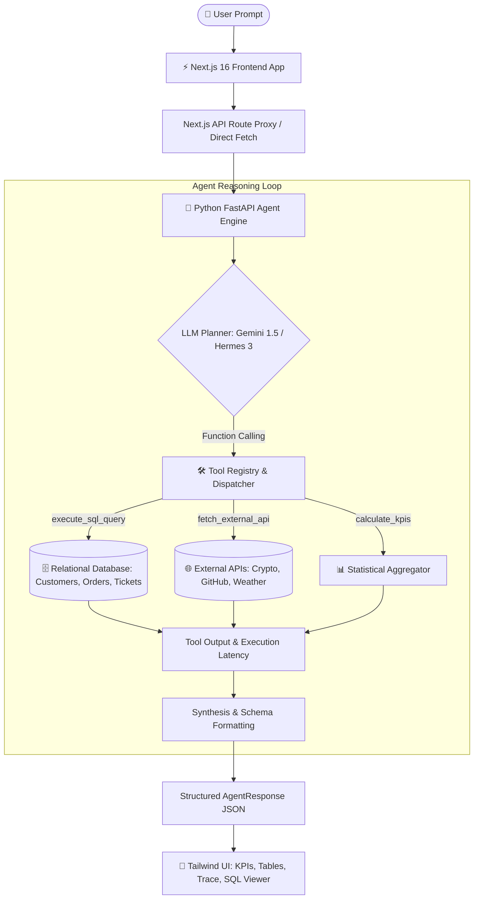

# ⚡ AI Agent Fullstack Hub

<p align="center">
  
</p>

<p align="center">
  <b>Enterprise Fullstack Autonomous AI Agent with Tool Calling (SQL + APIs), Next.js 16, Python FastAPI, and Tailwind CSS</b>
</p>

<p align="center">
  <a href="https://github.com/vestek70/ai-agent-fullstack-hub"></a>
  <a href="https://github.com/vestek70/ai-agent-fullstack-hub"></a>
  <a href="https://github.com/vestek70/ai-agent-fullstack-hub"></a>
  <a href="https://github.com/vestek70/ai-agent-fullstack-hub"></a>
  <a href="https://github.com/vestek70/ai-agent-fullstack-hub"></a>
  <a href="https://github.com/vestek70/ai-agent-fullstack-hub"></a>
</p>

---

## 🌟 Overview

**AI Agent Fullstack Hub** is a production-grade fullstack web application showcasing modern autonomous **AI Agent architecture** with **Function / Tool Calling**. 

The agent accepts natural language instructions, deterministically decides which local functions or external tools to trigger, executes low-latency SQL operations or web API requests, and synthesizes structured business responses displayed in a high-aesthetic Tailwind CSS dashboard.

### 🎯 Key Highlights
- **Natural Language to Deterministic Execution**: Transforms vague user requests into exact SQL queries or external API payloads.
- **Autonomous Tool Calling**:
  - 🗄️ **Corporate SQL Engine**: Queries relational PostgreSQL/SQLite tables (`customers`, `orders`, `products`, `order_items`, `support_tickets`) with sub-millisecond execution times.
  - 🌐 **Live Web APIs**: Real-time cryptocurrency rates (CoinGecko), GitHub repositories search, meteorological forecasts (Open-Meteo), and trending tech stories (HackerNews).
- **Multi-LLM Support**:
  - **Google Gemini 1.5 Pro / Flash** via Google GenAI Function Declarations.
  - **Nous Hermes 3** via Together AI or OpenAI-compatible tool calling endpoints.
  - **Instant Zero-Key Engine**: Built-in semantic engine that runs immediately out of the box with zero external dependencies or API keys required.
- **Tailwind UI with Glassmorphism**:
  - Live execution trace (Thought ➔ Tool Call ➔ DB/API Execution ➔ Synthesis).
  - Dynamic KPI metric cards with trends.
  - Interactive data tables with real-time text search and sorting.
  - Copyable SQL inspection with syntax highlighting and raw JSON payloads.
  - Relational database schema explorer.

---

## 🏗️ Architecture



---

## 🛠️ Supported Tools & Capabilities

| Tool Name | Type | Description | Sample Output |
| :--- | :--- | :--- | :--- |
| `execute_sql_query` | Database | Executes SQL queries across 5 relational enterprise tables with joins and aggregations. | Filtered rows, total counts, DB latency (~0.8ms) |
| `fetch_external_api` | External REST | Fetches live market quotes, repository stars, weather conditions, or news feeds. | Structured lists of assets, prices, and metrics |
| `calculate_kpis` | Analytics | Computes aggregate statistics (Sum, Mean, Min, Max, Count, Trend direction). | Formatted KPI objects with up/down trends |

---

## 📁 Repository Structure

```
ai-agent-fullstack-hub/
├── assets/
│   └── demo.gif                # 10-second high-resolution demo animation
├── backend/
│   ├── agent.py                # Agent reasoning engine (Gemini, Hermes, Semantic)
│   ├── database.py             # Enterprise DB schema (Customers, Orders, Tickets)
│   ├── generate_demo_gif.py    # GIF generation script using Pillow
│   ├── main.py                 # FastAPI REST API endpoints
│   ├── requirements.txt        # Python dependencies
│   ├── tools.py                # Tool definitions & dispatch logic
│   └── .env.example            # Environment configuration template
├── frontend/
│   ├── src/
│   │   └── app/
│   │       ├── api/agent/      # Next.js API proxy route
│   │       ├── globals.css     # Tailwind CSS v4 styling & animations
│   │       ├── layout.tsx      # Root metadata & fonts
│   │       └── page.tsx        # Interactive Tailwind UI & state management
│   ├── public/
│   │   └── demo.gif            # Demo asset for web app
│   ├── package.json            # Frontend dependencies
│   └── tsconfig.json           # TypeScript configuration
├── .gitignore                  # Monorepo ignore rules
└── README.md                   # Project documentation
```

---

## 🚀 Quickstart Guide

### 1. Clone the Repository
```bash
git clone https://github.com/vestek70/ai-agent-fullstack-hub.git
cd ai-agent-fullstack-hub
```

### 2. Launch Backend (Python FastAPI)
```bash
cd backend
python -m venv venv

# Windows
.\venv\Scripts\activate
# Linux/macOS
source venv/bin/activate

pip install -r requirements.txt
python main.py
```
> The API will be live at `http://127.0.0.1:8000` with Swagger docs at `http://127.0.0.1:8000/docs`.

### 3. Launch Frontend (Next.js)
In a separate terminal:
```bash
cd frontend
npm install
npm run dev
```
> Open [http://localhost:3000](http://localhost:3000) in your browser.

---

## 🔑 Environment Configuration (Optional)

Create a `.env` file inside `backend/` if you want to use real Gemini or Hermes models:

```env
# Google Gemini (Optional)
GEMINI_API_KEY=your_gemini_api_key_here

# Nous Hermes / Together AI (Optional)
HERMES_API_KEY=your_together_api_key_here
HERMES_API_BASE=https://api.together.xyz/v1
```

*Note: If no API keys are provided, the system seamlessly operates via the intelligent local agent engine with pre-seeded enterprise datasets!*

---

## 💼 LinkedIn Showcase ("Em Destaque")

This project is tailored for technical portfolios and LinkedIn featured sections:

### Quick Pitch (PT-BR)
> **🚀 AI Agent Fullstack Hub: Next.js + Python FastAPI + Autonomous Tool Calling**  
> Desenvolvi uma aplicação fullstack de Inteligência Artificial onde o agente (Gemini / Hermes) recebe instruções em linguagem natural, aciona ferramentas locais (SQL em banco relacional e consumo de APIs externas) e sintetiza dados em um dashboard reativo feito em Tailwind CSS.  
> 🔗 Repositório: https://github.com/vestek70/ai-agent-fullstack-hub

### Quick Pitch (EN)
> **🚀 AI Agent Fullstack Hub: Next.js + Python FastAPI + Autonomous Tool Calling**  
> Built an end-to-end AI Agent application capable of translating natural language requests into deterministic function calls (relational SQL execution & live external APIs) with rich structured synthesis in a modern Tailwind CSS dashboard.  
> 🔗 Repository: https://github.com/vestek70/ai-agent-fullstack-hub

---

## 📄 License

Distributed under the **MIT License**. See `LICENSE` for more information.

---

<p align="center">
  Developed by <b>Konstantin Borisov</b> (<b><a href="https://github.com/vestek70">@vestek70</a></b>)
</p>
